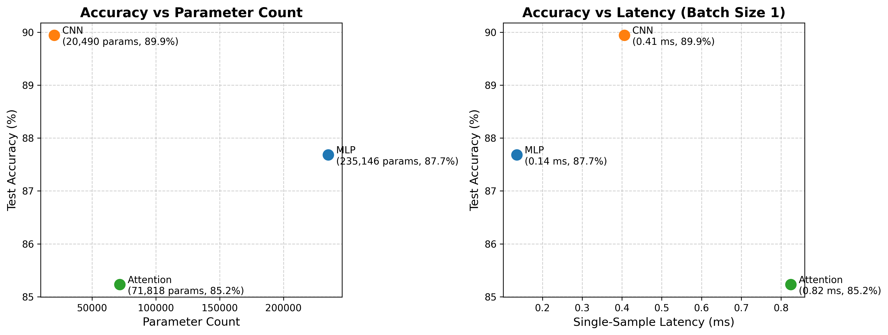
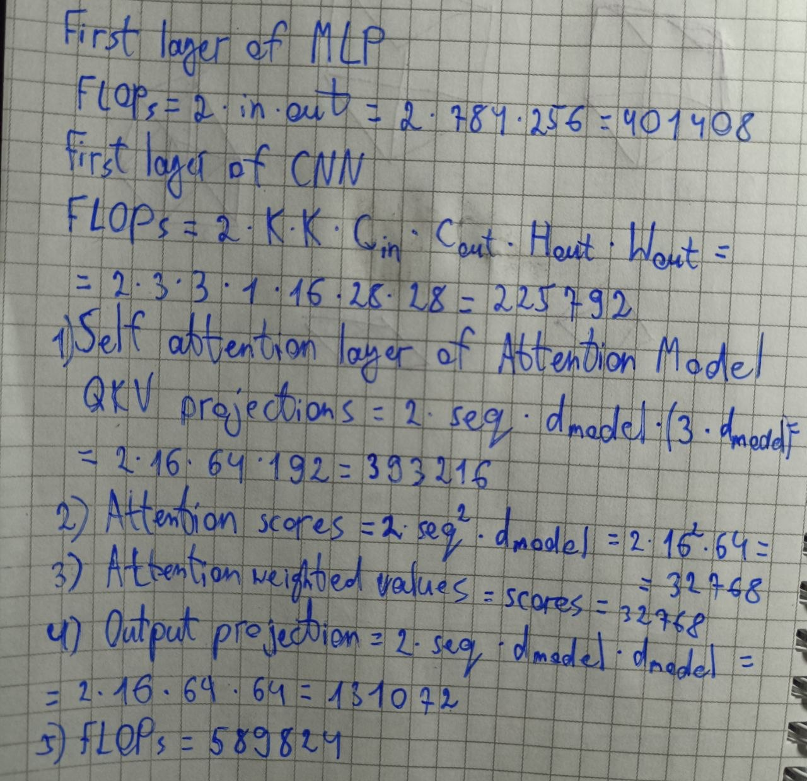

# Lab 03 Report: Architectures and their costs

## 1. Goal
The goal of this lab was to comapre three different netural network architectures: MLP, CNN and an Attention model on the FashionMNIST dataset. Specifically in this lab we compared their accuracies, number of parameters and FLOPs.

## 2. Method
* **Dataset & splitting:** Loaded an official FashionMNIST dataset and normalized the images using mean 0.2860 and standart deviation 0.3530. Split official 60k into 55k train and 5k validation and used official 10k test. Set batch size to 128
* **Architectures:**
  * **MLP:** Flatten 784 → Linear 256 → ReLU → Linear 128 → ReLU → Linear 10
  * **CNN:** Conv2d(1,16,3,padding=1) → ReLU → MaxPool2 → Conv2d(16,32,3,padding=1) → ReLU → MaxPool2 →
Flatten → Linear(32×7×7,10).
  * **Attention:** 28 x 28 image split into 16 patches of 7 x 7, linearly projected to 64, processed using 2 transformer encoder layers (4, 128), followed by mean pooling.
* **Training:** Trained for 5 epochs with Adam optimizer and with a learning rate of $1*10^{-3}$
* **Benchmarking:** Evaluated inference latency by taking the median 0f 100 runs for single-sample inference with batch size of 1. 
## 3. Results Table and plot

| Model | Params (torchinfo) | FLOPs (thop) | Batch 1 Latency (100 runs, ms) | Batch 128 Latency (20 runs, ms) | Accuracy (%) |
| :--- | :--- | :--- | :--- | :--- | :--- |
| **MLP** | 235,146 | 469,504 | 0.1190 | 0.7139 | 87.57 |
| **CNN** | 20,490 | 2,063,488 | 0.4066 | 8.7514 | 89.48 |
| **Attention** | 71,818 | 101,632 | 0.8289 | 7.8585 | 85.62 |

## 4. Three Conclusions
1. **The gap between hand-calculated and `thop.profile` FLOPs:** We can see that hand-calculated FLOPs differ drastically from `thop.profile` ones. This is because, as I understand, hand calculations simplify some weight operations, like MAC to FLOP conversions, ReLU functions, max-pooling comparisons, bias additions and auxiliary transformer components, which `thop.profile` includes in full.
2. **The most cost-effective architecture:** Out of all three architectures CNN seems the most cost-effective beacuse it requires the smallest number of parameters ($20,490$), while giving the highest accuracy ($89.48$%). Although CNN has higher latency that MLP, MLP uses way more parameters ($235,146$) and as a result MLP is less cost-effective.
3. **CNN is better than Attention on small images:** A comparison between CNN and Attention model shows that CNN gives a better accuracy, latency and uses fewer parameters, which tells us that Attention models aren't good on small scale vision tasks.